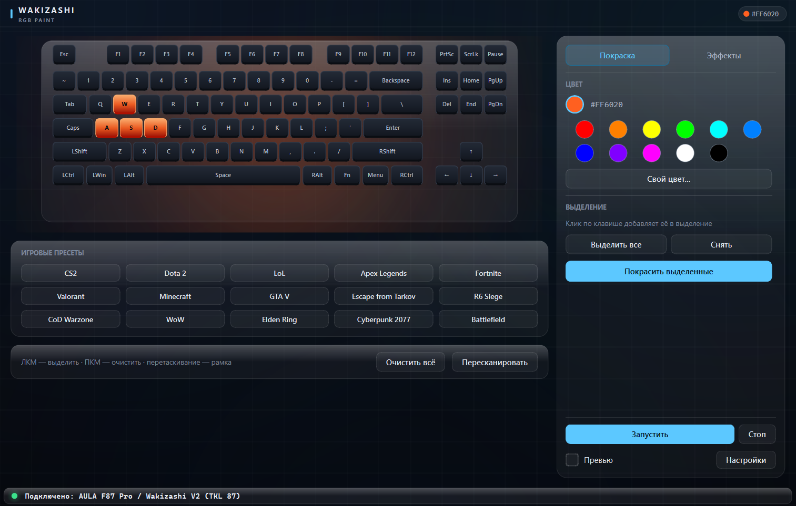
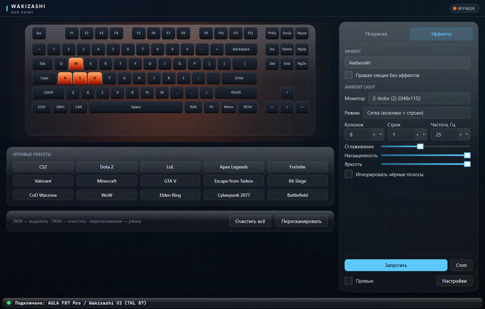

# Wakizashi RGB

Приложение для управления подсветкой клавиатур на контроллере SinoWealth: **ARDOR GAMING Wakizashi V2**, **AULA F87 Pro** и совместимых моделей.

Windows-only, Python + PyQt6. Работает напрямую через HID, без фирменного софта.



## Возможности

- Покраска отдельных клавиш и групп: выделение кликом или рамкой, пакетная заливка.
- 16 эффектов: статичный, дыхание, радуга, волна, амбилайт, игра, змейка, звёздный дождь, цветовой цикл, пульс, сканер, реактивный и 4 аудио-эффекта.
- 15 игровых пресетов: CS2, Dota 2, LoL, Apex Legends, Fortnite, Valorant, Minecraft, GTA V, Escape from Tarkov, R6 Siege, CoD Warzone, WoW, Elden Ring, Cyberpunk 2077, Battlefield.
- Ambilight: захват экрана, сетка колонок и строк, сглаживание, насыщенность и яркость.
- Аудио-реактивные эффекты: WASAPI loopback, спектр, осциллограф, пульс.
- Тёмная и светлая темы, тёмный заголовок окна в Windows.
- Настройки: автозапуск с Windows, сворачивание в трей, сброс настроек.
- CLI для быстрых операций без GUI.



## Поддерживаемые устройства

Основной протокол: SinoWealth, VID `0x258A`, Feature Report ID `0x06`.

| Model ID | Устройство |
|----------|------------|
| `0x0B` | AULA F87 Pro (TKL 87) |
| `0xBC` | AULA F87 Pro / Wakizashi V2 (TKL 87) |
| `0xCD` | AULA F75 |
| `0xA4` | AULA F99 |
| `0xA3` | LEOBOG Hi75C Pro |
| `0x20`, `0x05` | Redragon K686 Eisa Pro |

Сканируются PID `0x010C`, `0x010B`, `0x010A`, `0x010D`, `0x0109` — проводное подключение и 2.4 ГГц ресиверы. Другие клавиатуры с тем же lighting-интерфейсом могут работать, но не гарантируются.

Определить модель и HID-пути можно так:

```powershell
py -3 cli.py --detect
py -3 _scan.py
```

## Быстрый старт

1. Скачайте последний `WakizashiRGB_vX.Y.Z.exe` со страницы [Releases](https://github.com/maskboiii/wakizashi_rgb/releases/latest).
2. Подключите клавиатуру по USB или через 2.4 ГГц ресивер.
3. Запустите exe. Установка не требуется.

Если подсветка не реагирует, проверьте подключение и запустите `cli.py --detect` из исходников.

## Запуск из исходников

Требования: Windows 10/11, Python 3.10+ (проверено на 3.13), подключённая клавиатура.

```powershell
py -3 -m venv .venv
.venv\Scripts\activate
pip install -r requirements.txt
py -3 app.py
```

Опциональные зависимости:

- `mss` — захват экрана для Ambilight (без неё используется `QScreen.grabWindow`).
- `SoundCard` + `numpy` — аудио-реактивные эффекты.

## Как пользоваться

### Покраска

Режим выделения включён всегда.

- ЛКМ по клавише — добавить или снять выделение.
- Перетаскивание по пустому месту — выделить рамкой. Ctrl + рамка добавляет к текущему выделению.
- ПКМ — очистить клавишу.
- Клик по цвету палитры сразу красит выделенные клавиши; также можно нажать «Покрасить выделенные».
- «Выделить все» / «Снять» — управление выделением, «Очистить всё» — выключить подсветку.

### Эффекты

- Выберите эффект в списке. Набор параметров меняется автоматически: показываются только те, которые влияют на выбранный эффект.
- «Запустить» / «Стоп» / «Превью» закреплены внизу рейки и доступны без прокрутки.
- «Превью» проигрывает анимацию только в окне, без отправки на клавиатуру.
- «Правая секция без эффектов» исключает Ins/Home/PgUp/Del/End/PgDn, стрелки и PrtSc/ScrLk/Pause.

### Игровые пресеты

Клик по пресету очищает текущую раскраску, подсвечивает клавиши пресета и переключает эффект на «Игра». После этого можно нажать «Запустить» для анимации.

### Ambilight

Выберите монитор, режим захвата и сетку. «Сглаживание», «Насыщенность» и «Яркость» применяются к захваченным зонам. Для работы нужен `mss` или стандартный захват Qt.

### Аудио

Выберите loopback-устройство, количество полос, шкалу и параметры обработки. Эффект «Спектр» заполняет клавиши снизу вверх, «Осциллограф» рисует волну, «Аудио-пульс» реагирует на уровень.

### Настройки и трей

«Настройки» — автозапуск, тема, поведение при закрытии. При закрытии окно может свернуться в трей; выход — через меню иконки в трее.

## CLI

```powershell
py -3 cli.py --detect          # определить Model ID
py -3 cli.py --color ff6600    # залить одним цветом (keepalive до Ctrl+C)
py -3 cli.py --off             # выключить подсветку
```

## Сборка exe

```powershell
py -3 -m pip install pyinstaller
py -3 -m PyInstaller --clean --noconfirm WakizashiRGB.spec
```

Или запустите `build_wakizashi.bat`. Результат: `dist\WakizashiRGB_vX.Y.Z.exe`.

CLI собирается отдельно:

```powershell
py -3 -m PyInstaller --clean --noconfirm WakizashiCLI.spec
```

## Структура проекта

| Файл | Назначение |
|------|------------|
| `app.py` | GUI, эффекты, пресеты, Ambilight, аудио, трей |
| `kb.py` | HID-протокол SinoWealth, раскладка F87 |
| `theme.py` | токены DARK/LIGHT, QSS, стили кейкапов |
| `widgets.py` | aurora-фон, стеклянные панели, header, статус-бар, спектр |
| `cli.py` | консольный интерфейс: detect / color / off |
| `audio.py` | захват звука и анализ спектра |
| `_scan.py` | диагностика HID-устройств |
| `WakizashiRGB.spec` | сборка GUI через PyInstaller |
| `WakizashiCLI.spec` | сборка CLI через PyInstaller |
| `audio.md`, `meters.md` | заметки по аудио и внутреннему устройству |

## Как это работает

- Команды идут через Feature Reports с Report ID `0x06`; прошивка и bootloader не затрагиваются.
- Перед потоком per-LED цветов выполняется последовательность включения direct RGB режима.
- Direct RGB в прошивке энергозависим: без потока пакетов устройство возвращается к аппаратным эффектам примерно через секунду. Приложение отправляет keepalive каждые 100 мс.
- Эффекты рассчитываются на хосте и отправляются на клавиатуру; «Превью» подменяет отправку отрисовкой в окне.

## Ограничения

- Только Windows: используются WinAPI, реестр и WASAPI.
- После закрытия приложения подсветка возвращается к эффекту прошивки.
- Для Ambilight и аудио нужны дополнительные зависимости.
- Проект не связан с AULA, ARDOR GAMING и SinoWealth; используйте на свой риск.
